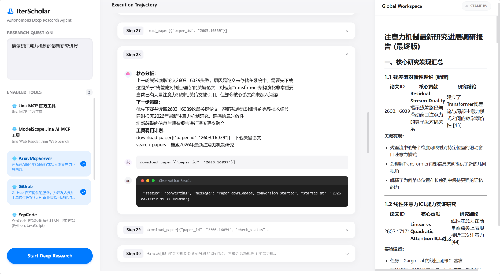
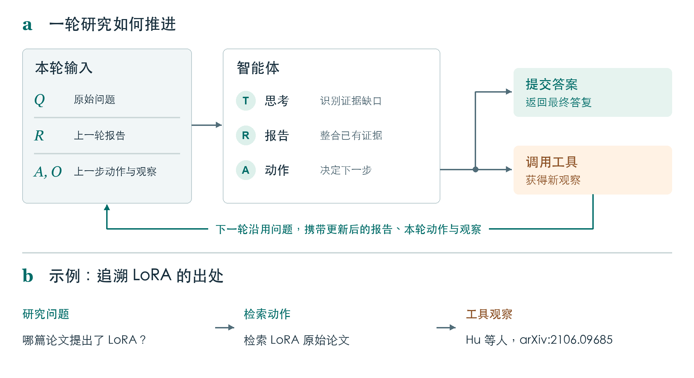
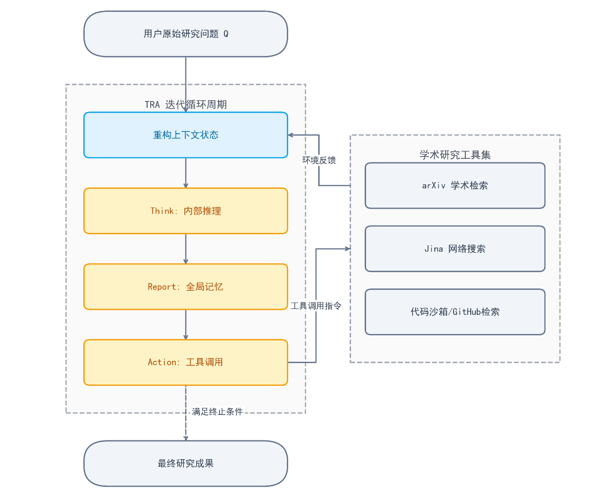
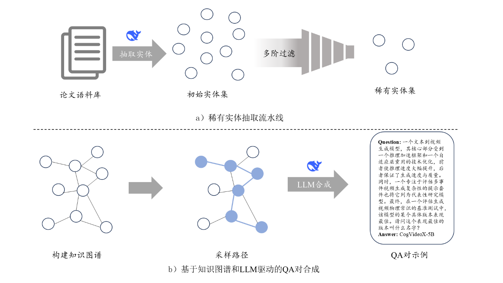

# IterScholar · 计算机科学文献深度研究智能体

**简体中文** · [English](README.en.md)

[离线示例](#从一道题开始) · [快速启动](#运行命令行智能体) · [网页界面](#网页界面) · [评测结果](#评测结果)

IterScholar 通过多轮检索回答需要组合多条文献线索的问题。每轮检索后，智能体把证据整理成一份研究报告，下一轮用这份报告决定还要查什么。仓库包含研究循环、CS-DeepSearchQA 题集、监督微调数据、评测记录和可视化界面。



*以调研注意力机制为例，展开中间的第 28 步可以看到论文下载动作及工具返回的结果，右侧保留当前研究报告。*

## 研究循环



每轮提示包含原始问题、当前报告、上一步动作及工具反馈。模型依次生成 `<think>`、`<report>` 和 `<action>`。引擎执行工具调用，用返回的观察结果和新报告重建下一轮状态。模型给出 `finish[答案]` 时返回答案，达到步数上限时返回未完成状态。完整轨迹单独保留，便于事后检查证据如何进入报告。见[引擎](react_agent/core/engine.py)、[状态管理](react_agent/core/memory.py)和[归档轨迹](react_agent/trajectories/)。

<details>
<summary>展开查看智能体架构与每轮状态</summary>



*IterScholar 执行架构。每轮更新报告后，智能体可调用 arXiv、Jina 或代码检索工具，再用返回的证据更新状态。*


*第 i 轮读取原始问题 Q、上一轮报告 R，以及上一步动作 A 和观察结果 O。图中 O(1) 指状态字段数量相对轮数保持固定，报告长度可以变化。*

</details>

## 从一道题开始

从仓库根目录运行下面的示例，只需 Python 3 标准库。它读取第一道题，按题干匹配裁判记录，并从逐题判决重算准确率。题集的第 1 题在评判文件中的键是 `4`，跨文件核对时应检查题干。

```python
import json
from pathlib import Path

splits = Path("dataset/CS_dataset/splits")
question = json.loads((splits / "benchmark_50.jsonl").read_text().splitlines()[0])
results = json.loads(Path("eval/judged_results/CS_qa/judged_IterScholar-SFT.json").read_text())
record = next(row for row in results.values() if row["question"] == question["question"])
print(question["question"])
print(question["answer"], record["judge_result"]["model_answer"], sep="\n")
correct = sum(row["judge_result"]["correct"] == "yes" for row in results.values())
print(f"{correct}/{len(results)} = {correct / len(results):.1%}")
```

这道题的参考答案是 `symmetric loss function`。裁判接受了模型给出的中文答案“对称损失函数训练”，整套题的输出为 `17/50 = 34.0%`。

## 运行命令行智能体

以下命令适用于 macOS 或 Linux，从仓库根目录执行。可使用 Python 3.11 新建环境。安装项依据推理入口的导入整理，仓库未锁定 Python 推理依赖的完整版本。

```bash
python3.11 -m venv .venv
source .venv/bin/activate
python -m pip install openai python-dotenv 'mcp>=1,<2' requests beautifulsoup4 arxiv fastapi uvicorn
```

在根目录的本地 `.env` 中填写服务商提供的值。`DMX_API_BASE` 是兼容 OpenAI Chat Completions 的 API 基础地址，`DMX_API_KEY` 是该服务的密钥。下例使用 Jina 搜索和网页读取工具，需要 `JINA_API_KEY`。 `RESEARCH_MODEL` 应填写服务端实际部署的模型 ID。

```dotenv
DMX_API_BASE=https://your-provider.example/v1
DMX_API_KEY=your-model-api-key
RESEARCH_MODEL=your-served-model-id
JINA_API_KEY=your-jina-api-key
```

在已激活的环境中运行以下示例。它会向模型和检索服务发起真实请求，最多执行 6 步。更多远程工具的地址和密钥变量见 [MCP 配置](react_agent/tools/mcp_configs.json)。

```bash
python - <<'PYTHON'
import os
from dotenv import load_dotenv
from openai import OpenAI

load_dotenv(".env")
from react_agent import LLMExecutor, ResearchLoop
from react_agent.tools.local_tool import JinaReaderTool, JinaSearchTool

client = OpenAI(base_url=os.environ["DMX_API_BASE"], api_key=os.environ["DMX_API_KEY"])
agent = ResearchLoop(
    tools=[JinaSearchTool(), JinaReaderTool()],
    llm_executor=LLMExecutor(client=client, model_name=os.environ["RESEARCH_MODEL"]),
    max_steps=6,
)
answer, trajectory, _ = agent.run("Who introduced LoRA? Cite the original paper.")
print(answer)
print(f"{len(trajectory)} steps")
PYTHON
```

## 网页界面

React 界面从 FastAPI 获取工具列表，通过服务器推送事件（SSE）展示报告、动作和观察结果。先启动后端，再用 `curl` 检查工具列表。前端会连接本机 8000 端口。

```bash
python backend/main_api.py
```

```bash
curl -fsS http://127.0.0.1:8000/api/tools
```

在另一终端从仓库根目录启动前端，打开 Vite 打印的本地地址。锁文件中的 Vite 要求 Node.js 20.19+（20.x）或 22.12+。

```bash
cd frontend
npm ci
npm run dev
```

网页中至少选择一个工具，再提交问题。后端通过 `GET /api/tools` 列出工具，通过 `GET /api/research` 接收 `query` 和可选的逗号分隔参数 `tools_idx`，依次推送步骤更新和最终答案。网页使用 `.env` 中的 `RESEARCH_MODEL`，省略时沿用默认值 `gpt-3.5-turbo`。

## 数据构建与监督微调



*上半图展示如何从文献语料中抽取并筛选稀有实体；下半图展示如何在知识图谱中采样路径，并用路径上的线索生成问答对。*

1. **构建题集。** 从[文献语料与实体统计](EntityCollection/)出发，在[构建笔记本](dataset/build_data.ipynb)中查看数据处理过程。[CS 数据划分](dataset/CS_dataset/splits/)包含 100 条 SFT 种子、261 条强化学习候选问题和 50 条基准题。每条基准记录含 `id`、`question`、`answer` 和 `seed_entity`。
2. **生成并筛选轨迹。** [批量采样脚本](SFT/async_run_sft_traj.py)生成多轮轨迹，[样本处理笔记本](SFT/process_sft_data.ipynb)整理训练数据。IterScholar 使用拒绝采样筛选训练轨迹，再进行监督微调。归档的[合并训练文件](SFT/data/merged_sft_data.jsonl)有 1,852 条记录。
3. **核对训练配置。** [原始参数](SFT/sft_log/args.json)记录了 ms-swift 4.0.2、基座 Qwen3.5-35B-A3B、LoRA 秩 32、alpha 64、学习率 0.0001、3 个 epoch 和最大序列长度 8,192。[训练日志](SFT/sft_log/)包含指标、验证样本和曲线。重新训练需要另行准备基座权重、训练环境，并调整归档配置中的机器路径。


*左图为训练与验证损失，右图为 token 准确率，红色虚线均代表验证集。下一节单独报告整道问题的答对率。*

## 评测结果

下表是仓库归档的准确率。CS-DeepSearchQA 共 50 题，BrowseComp-ZH 使用 [51 题子集](dataset/BrowseComp-ZH/browsecomp-zh-sample-51.json)。两组均以 GPT-5.4 为裁判。微调后的模型 IterScholar-CS-35B-A3B 在结果文件中记为 `IterScholar-SFT`。


<details>
<summary>查看精确数值</summary>

| 模型 | CS-DeepSearchQA | BrowseComp-ZH |
| --- | ---: | ---: |
| grok-3-deepsearch | 42% | 33.33% |
| IterScholar-SFT | 34% | 35.29% |
| claude-sonnet-4-6 | 20% | 21.57% |
| jina-deepsearch-v1 | 20% | 11.76% |
| claude-opus-4-6 | 16% | 37.25% |
| gpt-5.4 | 12% | 13.73% |
| kimi-k2.5-thinking | 10% | 37.25% |
| qwen3.5-plus | 10% | 25.49% |
| DeepSeek-V3.2-Thinking | 8% | 39.22% |

</details>

完整汇总还包含校准误差，见 [CS-DeepSearchQA](eval/CS-qa_evaluation_results.csv) 和 [BrowseComp-ZH](eval/browsecomp-zh_evaluation_results.csv)。评测流程依次为[生成预测](eval/async_run_react.py)、[裁判打分](eval/qa_judge.py)、[汇总指标](eval/metrics.py)。重新打分前需核对输入问题与预测的 ID、调整脚本中的绝对路径及数据集输出目录，并配置裁判使用的 `MY_DMX_API_KEY` 和 `DMX_API_BASE`。现成的[逐题判决](eval/judged_results/)可离线检查。

## 其他实验与许可证

[myRL](myRL/)、[myRL_local](myRL_local/) 和 [rollout_local](rollout_local/) 保存了强化学习调度、奖励与多轮采样实验。上表中的 IterScholar 结果来自监督微调模型。项目代码采用 [Apache License 2.0](LICENSE)。
