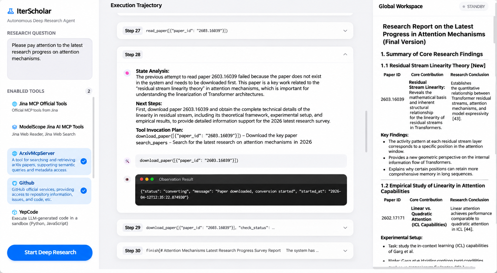
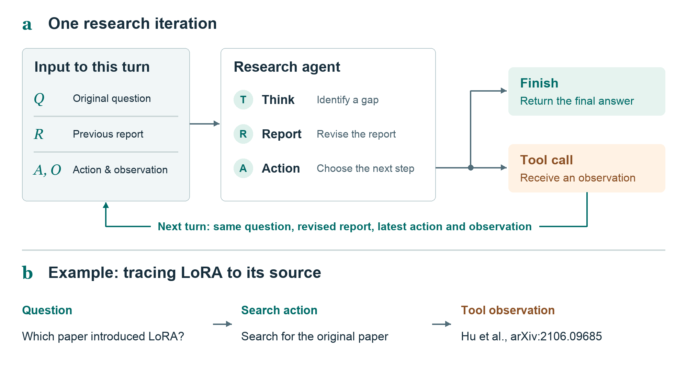
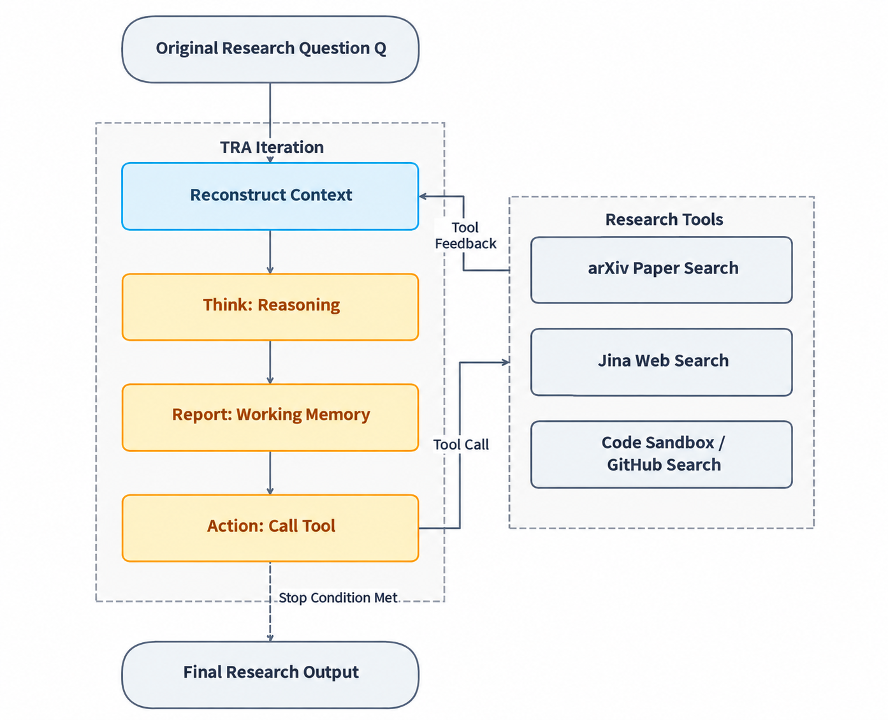
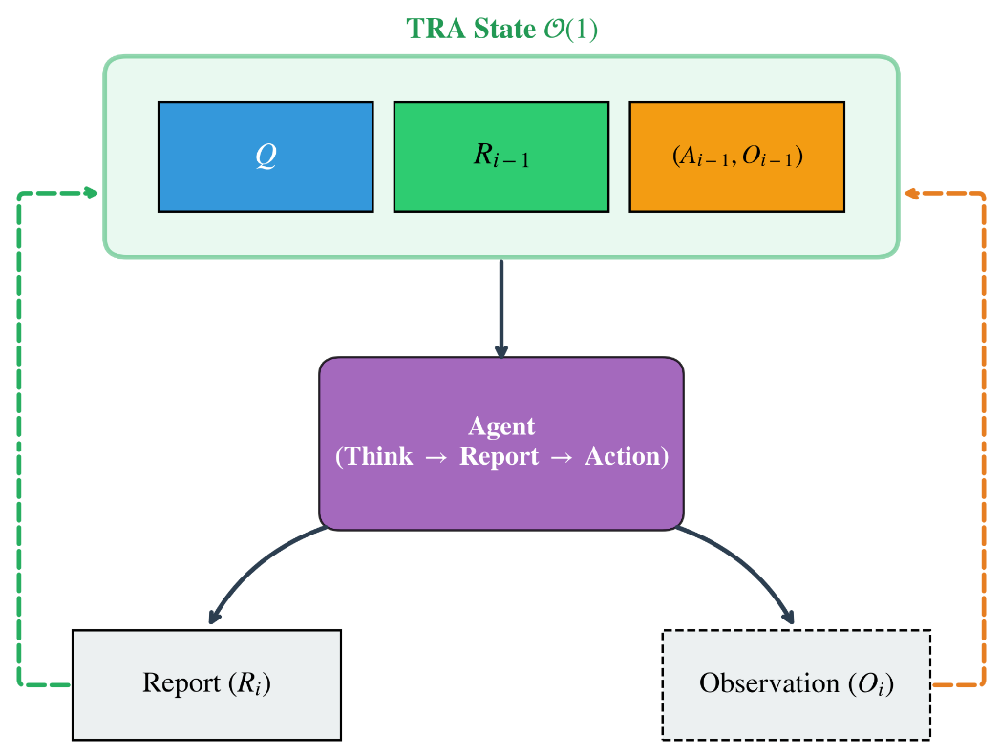
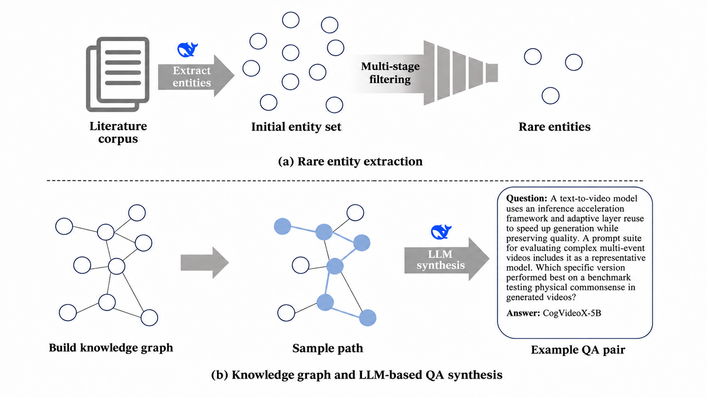
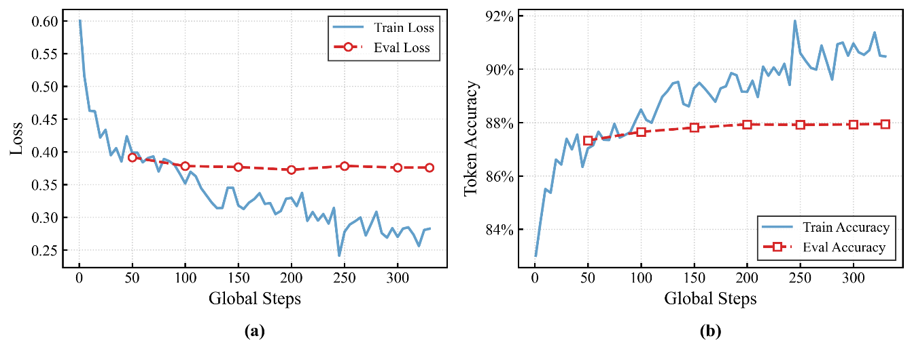
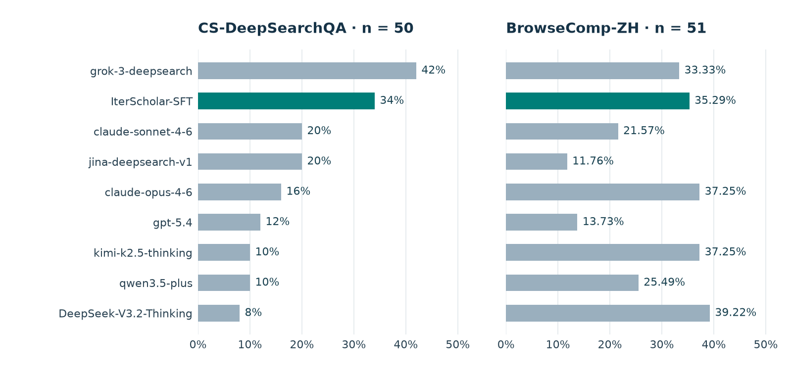

# IterScholar · Deep research for computer science literature

**English** · [简体中文](README.zh-CN.md)

[Offline example](#follow-one-benchmark-question) · [Quick start](#run-the-agent-from-python) · [Web interface](#web-interface) · [Benchmarks](#evaluation-results)

IterScholar answers questions that require piecing together clues from the computer science literature. After each retrieval step, the agent revises a research report and uses it to decide what to investigate next. The repository includes the research loop, the CS-DeepSearchQA benchmark, supervised fine-tuning data, evaluation records, and a web interface.



*English illustration adapted from the [original workspace screenshot](docs/images/workspace.png). In this investigation of attention mechanisms, step 28 shows a paper download and its tool response. The research report remains visible on the right.*

## How the research loop works

IterScholar’s research loop draws on IterResearch, a collaboration involving Alibaba’s Tongyi Lab. The agent keeps a running report of the evidence it gathers and uses that report as working memory for the next literature search. [IterResearch paper (ICLR 2026)](https://openreview.net/pdf?id=qQ5MZ5Mx7p)



Each prompt contains the original question, the current report, the previous action, and its tool observation. The model emits `<think>`, `<report>`, and `<action>`. The engine executes the action and builds the next state from the updated report and observation. A `finish[answer]` action returns the answer. Reaching the step limit returns an incomplete status. A separate trajectory preserves the steps for inspecting how evidence entered the report. See the [engine](react_agent/core/engine.py), [state manager](react_agent/core/memory.py), and [archived trajectories](react_agent/trajectories/).

<details>
<summary>Explore the agent architecture and per-step state</summary>



*IterScholar execution architecture. After updating its report, the agent can query arXiv, Jina, or a code search tool and carry the evidence into the next step.*



*Step i reads the question Q, previous report R, preceding action A, and observation O. O(1) describes the fixed number of state fields across steps. The report can vary in length.*

</details>

## Follow one benchmark question

Run this example from the repository root with the Python 3 standard library. It reads the first question, matches its judgment by question text, and recomputes accuracy from the individual verdicts. Question 1 has key `4` in the judgments file, so check the question text when matching records across files.

```python
import json
from pathlib import Path

splits = Path("dataset/CS_dataset/splits")
question = json.loads((splits / "benchmark_50.jsonl").read_text().splitlines()[0])
results = json.loads(Path("eval/judged_results/CS_qa/judged_IterScholar-SFT.json").read_text())
record = next(row for row in results.values() if row["question"] == question["question"])
print(question["question"])
print(question["answer"], record["judge_result"]["model_answer"], sep="\n")
correct = sum(row["judge_result"]["correct"] == "yes" for row in results.values())
print(f"{correct}/{len(results)} = {correct / len(results):.1%}")
```

The reference answer is `symmetric loss function`. The judge accepted the model’s Chinese answer describing training with a symmetric loss function. The final line for the full benchmark is `17/50 = 34.0%`.

## Run the agent from Python

Run the following commands from the repository root on macOS or Linux. Python 3.11 is a starting point for a fresh environment. The package list follows the inference code’s imports. The repository does not pin a complete Python inference environment.

```bash
python3.11 -m venv .venv
source .venv/bin/activate
python -m pip install openai python-dotenv 'mcp>=1,<2' requests beautifulsoup4 arxiv fastapi uvicorn
```

Set these values in a local `.env` at the repository root. Use the base URL and key for an OpenAI-compatible Chat Completions endpoint. This example uses Jina search and page reading, which require a Jina API key. Set `RESEARCH_MODEL` to the model ID served by your endpoint.

```dotenv
DMX_API_BASE=https://your-provider.example/v1
DMX_API_KEY=your-model-api-key
RESEARCH_MODEL=your-served-model-id
JINA_API_KEY=your-jina-api-key
```

Run the example in the activated environment. It makes live requests to the model and retrieval services, with a limit of six steps. For additional remote tools, see the endpoint and key variable names in the [MCP configuration](react_agent/tools/mcp_configs.json).

```bash
python - <<'PYTHON'
import os
from dotenv import load_dotenv
from openai import OpenAI

load_dotenv(".env")
from react_agent import LLMExecutor, ResearchLoop
from react_agent.tools.local_tool import JinaReaderTool, JinaSearchTool

client = OpenAI(base_url=os.environ["DMX_API_BASE"], api_key=os.environ["DMX_API_KEY"])
agent = ResearchLoop(
    tools=[JinaSearchTool(), JinaReaderTool()],
    llm_executor=LLMExecutor(client=client, model_name=os.environ["RESEARCH_MODEL"]),
    max_steps=6,
)
answer, trajectory, _ = agent.run("Who introduced LoRA? Cite the original paper.")
print(answer)
print(f"{len(trajectory)} steps")
PYTHON
```

## Web interface

The React interface loads a tool list from FastAPI and uses server-sent events (SSE) to display reports, actions, and observations. Start the backend, then check the tool list with `curl` in another terminal. The frontend connects to port 8000 on the local machine.

```bash
python backend/main_api.py
```

```bash
curl -fsS http://127.0.0.1:8000/api/tools
```

Start the frontend from the repository root in a separate terminal and open the local URL printed by Vite. The locked Vite version requires Node.js 20.19+ on the 20.x line, or 22.12 and later.

```bash
cd frontend
npm ci
npm run dev
```

Select at least one tool in the web interface and submit a question. The backend lists tools at `GET /api/tools`. `GET /api/research` accepts `query` and optional comma-separated `tools_idx`, then streams step updates and the final answer. The backend reads `RESEARCH_MODEL` from your environment and defaults to `gpt-3.5-turbo` when it is unset.

## Data preparation and supervised fine-tuning



*The upper panel shows how rare entities are extracted and filtered from the literature. The lower panel shows how paths sampled from a knowledge graph supply clues for question–answer pairs.*

1. **Build the questions.** Start with the [literature corpus and entity statistics](EntityCollection/) and the [data preparation notebook](dataset/build_data.ipynb). The [CS splits](dataset/CS_dataset/splits/) contain 100 SFT seed questions, 261 candidate questions for reinforcement learning, and 50 benchmark questions. Each benchmark record contains `id`, `question`, `answer`, and `seed_entity`.
2. **Sample and filter trajectories.** The [batch sampler](SFT/async_run_sft_traj.py) generates multi-turn trajectories. The [processing notebook](SFT/process_sft_data.ipynb) prepares training examples. IterScholar uses rejection sampling to select trajectories for supervised fine-tuning. The archived [merged training file](SFT/data/merged_sft_data.jsonl) contains 1,852 records.
3. **Inspect the training configuration.** The [saved arguments](SFT/sft_log/args.json) record ms-swift 4.0.2, the Qwen3.5-35B-A3B base model, LoRA rank 32 and alpha 64, learning rate 0.0001, three epochs, and a maximum sequence length of 8,192. The [training logs](SFT/sft_log/) include metrics, validation examples, and curves. Retraining requires the base weights, a training environment, and local replacements for machine-specific paths in the archive.



*Training and validation loss (left) and token accuracy (right) across training steps. Red dashed lines show validation metrics. The next section reports accuracy on complete benchmark questions.*

## Evaluation results

The table reports archived accuracy on the 50-question CS-DeepSearchQA benchmark and the [51-question BrowseComp-ZH subset](dataset/BrowseComp-ZH/browsecomp-zh-sample-51.json). GPT-5.4 judged both sets. The fine-tuned model, IterScholar-CS-35B-A3B, appears as `IterScholar-SFT` in the result files.



<details>
<summary>View exact scores</summary>

| Model | CS-DeepSearchQA | BrowseComp-ZH |
| --- | ---: | ---: |
| grok-3-deepsearch | 42% | 33.33% |
| IterScholar-SFT | 34% | 35.29% |
| claude-sonnet-4-6 | 20% | 21.57% |
| jina-deepsearch-v1 | 20% | 11.76% |
| claude-opus-4-6 | 16% | 37.25% |
| gpt-5.4 | 12% | 13.73% |
| kimi-k2.5-thinking | 10% | 37.25% |
| qwen3.5-plus | 10% | 25.49% |
| DeepSeek-V3.2-Thinking | 8% | 39.22% |

</details>

The summaries also report calibration error. See [CS-DeepSearchQA](eval/CS-qa_evaluation_results.csv) and [BrowseComp-ZH](eval/browsecomp-zh_evaluation_results.csv). The evaluation pipeline runs [prediction generation](eval/async_run_react.py), [model judging](eval/qa_judge.py), and [metric aggregation](eval/metrics.py). Before rejudging, match question IDs to prediction IDs, adapt the absolute paths and dataset output directory, and configure the judge’s `MY_DMX_API_KEY` and `DMX_API_BASE`. The archived [per-question judgments](eval/judged_results/) can be inspected offline.

## Additional experiments and license

[myRL](myRL/), [myRL_local](myRL_local/), and [rollout_local](rollout_local/) contain experiments with reinforcement learning schedulers, rewards, and multi-turn rollouts. The IterScholar results above come from supervised fine-tuning. The project code is licensed under the [Apache License 2.0](LICENSE).
