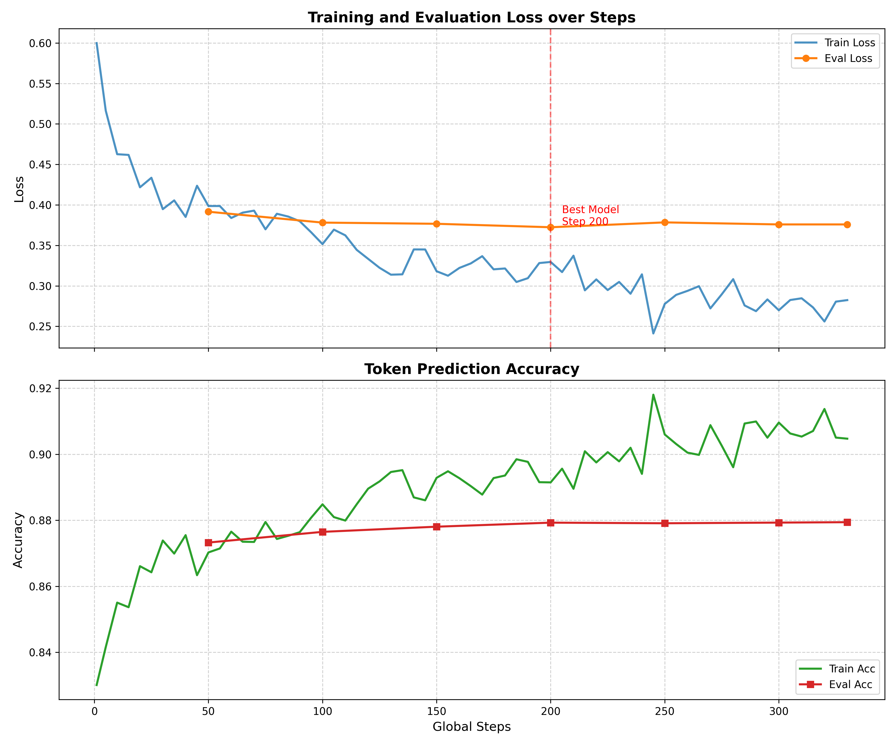

## 深度研究智能体 SFT 训练报告
**日期**: 2026-03-21
**总步数**: 330 步 (3 Epochs)

### 核心指标总结
* **初始训练 Loss**: 0.5998
* **最终训练 Loss**: 0.2824
* **最佳验证 Loss**: 0.3724 (出现在第 200 步)
* **最终训练准确率**: 90.47%

### 趋势分析
训练过程平稳收敛。验证集 Loss 在第 200 步达到最佳点后出现轻微平台期/反弹，表明模型已充分吸收数据集中的 CoT 推理模式。建议在推理阶段直接加载 `checkpoint-200` 权重，以获得最佳的泛化能力。

